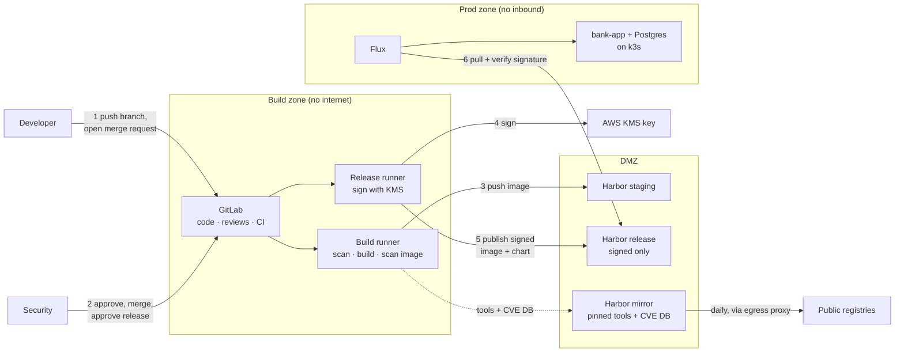
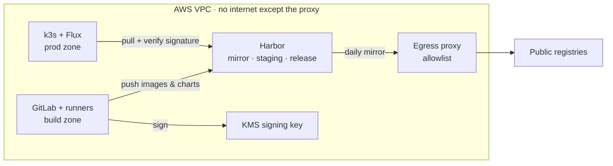
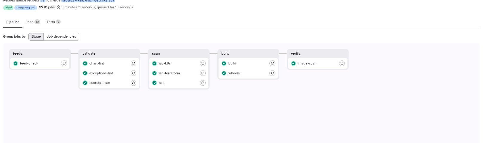
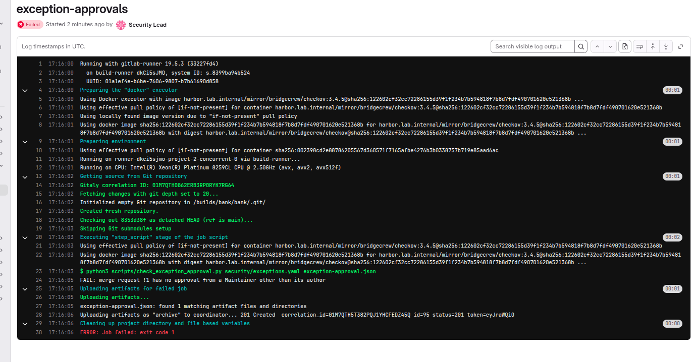
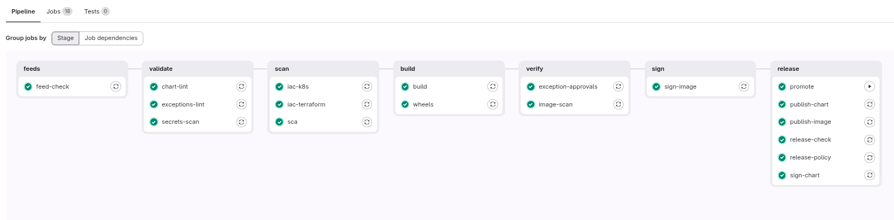
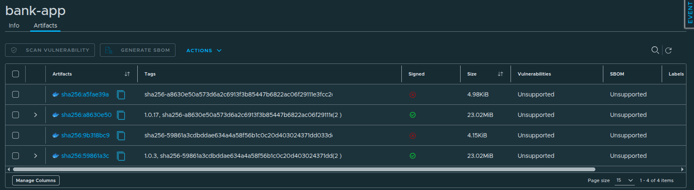
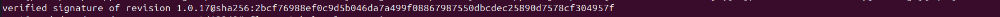
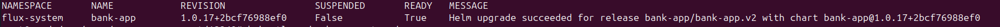

# Hardened Enterprise Pipeline: internal banking service

## The assignment

Build a Git repository from scratch with a secure, automated CI/CD pipeline for an internal banking service,
under two constraints:

- **No outbound internet.** CI runners work in an isolated network with no access to public repositories or
  vulnerability feeds while they run.
- **Domain isolation.** The runners sit in a different zone than production, and direct connections from the
  runners into production (SSH, WinRM) are blocked.

What was asked:

1. **Application and SCA.** A small web service (under 50 lines) with a database connection and a health check,
   whose dependencies include a known High/Critical CVE. An offline dependency scanner that fails the pipeline on
   Critical findings, plus a clean, auditable way to accept one specific CVE in an emergency.
2. **IaC and scanning.** Infrastructure as code for the runtime (workloads, network rules, configuration), hardened
   to limit the blast radius, and scanned by an IaC scanner before anything is deployed.
3. **Cross-domain deployment.** Since CI cannot push into production, a pull-based (GitOps) design, with the
   integrity of every artifact verifiable between the zones.
4. **DECISIONS.md.** Short answers on stale vulnerability feeds, deploying to legacy AD-joined servers, and
   handling an unpatched dependency.

## Architecture: the flow



A secure CI/CD pipeline for a small banking service. CI and production have **no internet**, every
dependency is checked, every release is **signed** and approved by a person, and production **pulls**
releases itself. Nothing ever pushes into it. The whole lab comes up with one command, `make up`, and every
security control has a negative test that proves it blocks what it should (`make test`, `make test-lab`).

## How it works

1. **Harbor brings outside content in.** Harbor (the registry) copies a fixed list of pinned images from public
   registries once a day: CI tools, base images, the database image, Flux, and Trivy's vulnerability database.
   It is the only server allowed out, through a proxy that allows only those registries.
2. **Python packages come in once, checked.** The exact versions and hashes in `app/requirements.txt` are
   uploaded to GitLab's internal package registry. CI installs only from there.
3. **A developer pushes a branch** to GitLab. The pipeline runs on the **build runner**: no internet, no cloud
   permissions, cannot sign.
4. **Security gates run first:** vulnerability database fresh, no Critical CVE in dependencies (Trivy), Terraform
   and Kubernetes files secure (Checkov), no secrets in Git history (gitleaks), exceptions valid.
5. **A Critical CVE stops the pipeline.** The only way through is a merge request adding a short, documented
   exception for that one CVE in that one package version. Only Security can merge it, and the pipeline checks
   GitLab's record that Security really approved it.
6. **The images are built and scanned again**: the app image and the database image the release uses.
7. **Only `main` can be released, only by a person.** The **release runner** signs the image with a key in
   **AWS KMS** (the key never leaves KMS). The pipeline then waits for Security to press **promote**.
8. **Re-checked, then published.** After the approval, exceptions, approvals, database freshness and a rescan of
   both images are checked again. Then the image goes to Harbor `release` with a signed **evidence record**, and a
   signed Helm chart (with the image digest inside) is published. Harbor `release` accepts only signed artifacts.
9. **Production pulls it.** Flux inside prod sees the new version, **verifies the signature**, and installs it
   with permissions for one namespace only.



**Nothing connects into prod.** Build and prod are in separate network zones that cannot reach each other.
Harbor is the only bridge: CI writes to it, prod reads from it.

## The pipeline

| Stage | Jobs | What and why |
|---|---|---|
| feeds | `feed-check` | Gets the vulnerability DB from Harbor; stops if it is missing, older than 48 h, or dated in the future. |
| validate | `exceptions-lint`, `secrets-scan`, `chart-lint` | Exceptions are strict and short-lived; no secrets in Git; the chart is valid. |
| scan | `sca`, `iac-terraform`, `iac-k8s` | Trivy: no Critical CVE in Python packages. Checkov: Terraform and Kubernetes in separate jobs, each failing if it scanned nothing. |
| build | `wheels`, `build` | Installs packages only from the internal registry, builds the image into Harbor `staging`. |
| verify | `image-scan`, `exception-approvals` | Scans the app image **and** the database image. On `main`, proves every exception was approved by Security. |
| sign | `sign-image` | `main` only, on the release runner: signs with the KMS key. |
| release | `promote` (manual), `release-check`, `release-policy`, `publish-image`, `publish-chart`, `sign-chart` | Security approves; everything that can expire is re-checked; the signed image, its signed evidence and the signed chart go to Harbor `release`. |

**Branch vs `main`:** a merge request pipeline only checks, builds and scans. It has no signing or release jobs.
After merging, `main` runs everything again on the exact merged code, signs it, and waits for the manual release.

### What the demo shows (step by step)

**1. The first pipeline on `main` is blocked.**


`sca` fails and everything after it is skipped: no build, no signing, no release. Gates fail closed.

**2. Why it failed: a Critical CVE in a dependency.**


Trivy, scanning offline with the database from the Harbor mirror, found **CVE-2022-21797** (Critical) in
`joblib 1.1.0`. **Status `fixed`** means a patched version exists (1.2.0): the real fix is to upgrade.

**3. The same finding, without reading logs: the pipeline's Tests tab.**


Every blocking Critical is published as a failed test, so it shows in the Tests tab and in merge requests.

**4. The exception, through a merge request.** When a team cannot upgrade right away, the developer adds one
short-lived entry to `security/exceptions.yaml`:

```yaml
vulnerabilities:
  - id: CVE-2022-21797
    purls:
      - "pkg:pypi/joblib@1.1.0"        # exactly one package, exactly this version
    expired_at: 2026-12-02             # at most 30 days ahead
    statement: "ticket=SEC-101; approved-by=security-lead; reason=...; compensating=..."
```



The merge request pipeline is green: Trivy skips only that CVE in that exact version (another version, or any
other Critical, still fails). It has **no signing or release jobs**, and the developer cannot merge it.

**5. Four eyes, enforced.**



On `main`, `exception-approvals` checks GitLab's own record: the change must come from a merge request approved by
a Maintainer (Security) who is not its author. A self-approved exception, or one merged without any approval, is
stopped here, before anything is signed.

**6. The release, approved by a person.**



With a proper approval, `main` runs every gate again, `exception-approvals` passes, and `sign-image` signs the image
with the KMS key. The pipeline then waits until Security presses **promote**. `release-check` and `release-policy`
re-check everything that can expire and build the evidence record; `publish-image`, `publish-chart` and
`sign-chart` publish the signed release.

**7. The signed release in Harbor.**



`release/bank-app`: each release image (`1.0.N`) is **Signed** with the KMS key. The small `sha256-…` artifact next to
it is that release's **evidence record** (a cosign attestation: what was scanned, which exception applied, who
approved). Its signature is inside the record and is checked with `cosign verify-attestation`, which is why
Harbor's "Signed" column shows ✗ for it.


`release/charts/bank-app`: the Helm chart of each release, signed, with the image digest baked in. This is what Flux
in prod pulls; it verifies the signature before installing, within about a minute.

**8. Production pulled, verified and deployed it** (commands run on the prod VM).


`flux get sources oci -A`: Flux pulled release `1.0.17` from Harbor's `release` project, by digest. Prod fetched it
itself; nothing pushed into prod.



The `SourceVerified` condition: Flux checked the chart's cosign signature against the KMS public key **before**
using it. The digest is the same as the signed chart in Harbor (`sha256:2bcf7698…`).



`flux get helmreleases -A`: Helm upgrade succeeded with chart `bank-app@1.0.17`, so that release is what runs.


`kubectl -n bank-app get pods`: both app replicas and the database are `1/1 Running`. An app pod is only Ready when
its `/healthz` check passes, and that check queries the database, so the app is connected to Postgres (over TLS).

**How Flux knows what to pull.** It does not just take "the newest thing". It follows the rule in
[platform/flux/bank-app.yaml](platform/flux/bank-app.yaml):

```yaml
url: oci://harbor.lab.internal/release/charts/bank-app
ref:
  semver: ">=1.0.0"
```

1. Every minute, Flux lists the chart versions in Harbor's `release` project.
2. It picks the **highest version** matching `>=1.0.0`, compared as version numbers (now `1.0.17` over `1.0.3`).
3. It **verifies that chart's signature** with the KMS public key. If it is unsigned or signed by another key, Flux
   refuses it and keeps running the current release.
4. If the version is new, it upgrades the app to that chart. The image digest is baked into the chart, so the exact
   signed image is what runs.

Only the pipeline's release jobs can put charts into `release`, and only after Security's approval; release
versions can never be overwritten, and an older version can't be "replayed" because Flux always takes the highest.

## Security considerations

Each point says what is enforced and how it is proven. Local tests: `make test` (no AWS). Lab tests:
`make test-lab` (against the running lab).

**Network**
- No internet for any server except the egress proxy, which allows only listed domains and logs every request.
- Installers get internet only during setup, as a **maintenance window**: CI runners are stopped first, the
  window closes on success or failure (and by itself after 60 minutes), and the runners start again only after
  a check proves they have no internet, directly or through the proxy. *(make up verifies it; test-lab)*
- Build and prod zones are blocked from each other at the subnet firewall; prod accepts no incoming connections.
- Inside Kubernetes, network policies deny everything except app → database and DNS.

**Identity and least privilege**
- Each server has its own AWS role and can read and decrypt **only its own secrets**: a custom SSM agent policy
  (not AWS's managed one, which allows reading every parameter), every read action scoped, and a dedicated KMS
  key that lets each role decrypt only its own paths. *(test-lab: IAM policy simulation)*
- Only the release runner's role can use the signing key, and only for `main`. *(test-lab)*
- The lab's AWS user can create roles only with a **permissions boundary** it cannot remove, and can pass roles
  only to EC2, so it cannot turn a role into an administrator. *(test-lab: escalation paths denied)*
- **Flux least privilege:** its default cluster-admin binding is removed; it installs the app only by
  impersonating one service account that has rights in the `bank-app` namespace for the chart's resource kinds;
  anything else gets no permissions. *(test-lab: `kubectl auth can-i`)*
- The app logs in to the database as a normal role: no superuser, cannot create roles or databases. The admin
  password exists only in the database pod. *(make test: real database; test-lab)*
- Developers cannot merge to `main` or release; Security approves every merge and every release.

**Secrets**
- No secrets in Git (gitleaks checks the whole history).
- Passwords and tokens are generated during setup and kept in AWS Parameter Store, encrypted with the lab's own
  KMS key. The database passwords and its TLS keys are created inside the cluster and never leave it.
- The signing key's private half exists only in AWS KMS; its public half is not secret.

**Supply chain**
- Every CI tool image is pinned **by digest**, and Harbor checks each mirrored tool against that reviewed digest.
  Base images are pinned by digest at import; Python packages by version and hash.
- Gates fail closed: stale or future-dated vulnerability DB, Critical CVEs in packages, the app image or the
  database image, insecure IaC, leaked secrets. *(make test: feed boundaries, IaC gate with the exact CI image)*
- Exceptions: one CVE, one exact package version, ticket, reason, compensating control, at most 30 days, and
  proof of Security's approval from GitLab. *(make test: invalid exceptions rejected; scope limited to one version)*
- Re-checked at release time, after the manual approval, so nothing expired can be published.
- Images and charts are signed; Harbor `release` serves only signed artifacts and never overwrites a version;
  Flux verifies before installing; the chart pins the exact image digest.
- **Audit evidence:** full scan reports including findings an exception suppressed, plus a signed evidence record
  attached to the released image (commit, digests, scanner and DB version, exception, approvals), kept 1 year.

**Data and runtime**
- App ↔ database traffic is **TLS-only**: the database refuses plaintext logins, and the app checks the server
  certificate and hostname. *(make test: untrusted CA, wrong hostname and plaintext server all refused)*
- Pods run as non-root, read-only, with no privileges, no capabilities and no service-account token, enforced by
  Kubernetes (Pod Security `restricted`). Minimal images: distroless app, Chainguard database.
- Deployment is verified against the **exact expected** version and image digest, with a verified signature and
  a real `{"status": "ok"}`. *(make test: old release, unverified source, stale status, failed rollout rejected)*

**Infrastructure**
- `make up` checks the Terraform code (format, validation, Checkov) **before** changing anything in AWS, then
  applies exactly the checked plan. *(make test: an insecure rule never reaches `terraform apply`)*
- Encrypted disks, IMDSv2, VPC flow logs, TLS everywhere with a dedicated lab CA, no SSH (SSM only).
- Terraform state is in an encrypted, private, versioned S3 bucket.

## Tools and why

| Tool | Why |
|---|---|
| Terraform | Infrastructure as code: reviewable, repeatable, scanned before apply. |
| GitLab (self-hosted) | Code, reviews, CI and a package registry in one tool that runs **fully inside the air gap**. GitHub Actions was not an option: it is a cloud service, and its self-hosted runners still need to reach GitHub over the internet, which the build zone does not have. |
| Harbor | Self-hosted registry with scheduled mirroring, signed-only releases and immutable tags. |
| Squid | Simple, proven egress proxy with domain allowlists and full logs. |
| Trivy | Offline vulnerability scanning with exact, expiring exceptions. |
| Checkov | Security checks for Terraform and Kubernetes files. |
| gitleaks | Finds secrets in code and history, offline. |
| cosign + AWS KMS | Signing where the private key can never be copied. |
| Helm | Packages the release; the signed chart pins the image digest. |
| k3s | Certified Kubernetes in one small VM: cheap (no control-plane fee), starts in minutes, and installs fully offline from its image bundle. EKS would cost more (~$0.10/h for the control plane plus nodes), needs extra private endpoints, and adds nothing to what this assignment demonstrates; the chart and Flux setup would carry over to EKS unchanged. |
| Flux | Pull-based: it runs inside prod and fetches releases, so prod opens no port. It **verifies cosign signatures natively** before installing, can install each release with a limited service account (least privilege), and is light (2 controllers, no UI to expose). Argo CD is a good tool too, but it is heavier, centres on a web UI and API server that must be secured, and has no built-in cosign verification of OCI charts. |
| Chainguard PostgreSQL | Minimal database image with no Critical or High CVEs (the official images ship a vulnerable helper). |
| AWS SSM | Shell access with no SSH keys or open ports. |

## Users

| Who | Role |
|---|---|
| AWS `bank-lab-admin` | Builds the lab; bound so it cannot give itself or any role more rights. |
| AWS VM roles | One per server: its own secrets only; only the release runner may sign. |
| GitLab `omeriko` | Developer: branches and merge requests only. |
| GitLab `security-lead` | Security: approves and merges, approves releases. |
| GitLab `exception-audit` token | Read-only: lets CI check approvals on merge requests. |
| Harbor robots | `ci-build` (staging), `ci-release` (staging + release, main only), `prod-pull` (read release only). |
| Flux `bank-app-deployer` | Installs the app, only in its namespace. |
| Postgres `postgres` / `bank_app` | Admin (only inside the database pod) / the app's normal login. |

## Run it

```bash
bash scripts/create-lab-user.sh   # once, as an AWS administrator (e.g. CloudShell): user + boundary
cp lab.env.example lab.env        # AWS profile, region; DEMO=manual to click through the demo yourself
make up                           # checks, then builds everything (~15 min, ~26 with DEMO=auto)
make passwords                    # logins
make vpn                          # VPN profile, then open https://gitlab.lab.internal and https://harbor.lab.internal
make status                       # what is running in prod
make test                         # local negative tests (no AWS)
make test-lab                     # negative tests against the running lab
make down                         # delete everything
```

Needs: AWS CLI v2 (+ Session Manager plugin), Terraform ≥ 1.11, Checkov, Docker (for `make test`), `jq`, `git`,
`openssl`, `make`. Details for every step: `BUILD_GUIDE.md`. Trade-off decisions: `DECISIONS.md`.

## Known gaps

- **Single node.** k3s and the database share one VM, and there are no backups. A bank would define RPO/RTO,
  run the database with backups and point-in-time recovery, and test restores.
- **Distribution-specific bootstrap.** The chart and Flux objects would carry over to EKS; the k3s bootstrap
  (registry config, kubeconfig, local storage) would be replaced by EKS node and storage configuration.
- **Client path.** The app is internal (ClusterIP) and checked with `kubectl port-forward`; a real deployment
  would add an internal gateway with its own allowlist and TLS.
- **Code owners.** GitLab's free tier does not enforce `CODEOWNERS`; four eyes comes from roles plus the
  `exception-approvals` check of GitLab's approval record.
- **Audit retention.** AWS keeps API events (CloudTrail event history) for 90 days and Session Manager session
  transcripts are not recorded here; a bank would ship both, and pipeline evidence, to a central long-term store
  with alerting (e.g. paging the feed owner when `feed-check` fails).
- **Builds.** Buildah needs seccomp and AppArmor relaxed and `/dev/fuse` on the build runner (still not
  privileged); production would build on dedicated, short-lived build VMs.
- **Scripted demo.** `DEMO=auto` approves with the approvers' API tokens; it demonstrates the flow but is not
  evidence of independent human review.
